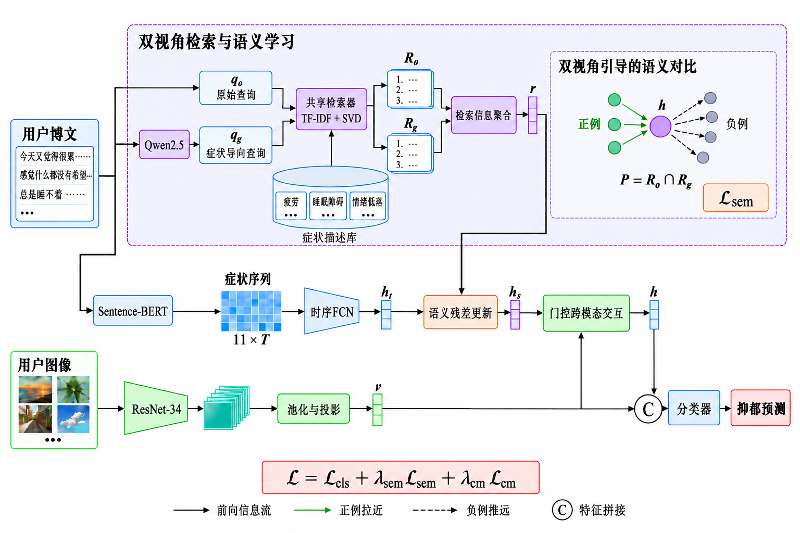

# DVSRC-Net: Dual-View Symptom Retrieval and Contrastive Learning Network

PyTorch implementation of **Depressive Tendency Detection Based on Dual-View Symptom Retrieval and Contrastive Learning**.

## Framework



## Environment

Python 3.10, PyTorch 2.7.1, and CUDA 11.8.

```bash
pip install -r requirements.txt
```

## Dataset and Pretrained Model

Obtain [SWDD](https://github.com/ethan-nicholas-tsai/SWDD) from the dataset authors. Prepare cleaned posts, DSTS text features, and ResNet-34 image features.

Symptom-query generation uses `Qwen/Qwen2.5-3B-Instruct`. A local model directory can be supplied with `--qwen-model`.

Datasets and model weights are not included in this repository.

## Data Preparation

Place the following aligned files in `data/raw/`:

| File | Required contents |
| --- | --- |
| `users.jsonl.gz` | One object per user: `user_id` and cleaned `texts`. Uncompressed `users.jsonl` is also supported. |
| `split_manifest.npz` | `user_id`, `split` (0: train, 1: validation, 2: test), and binary `label`. |
| `modalities.npz` | `user_id`, DSTS `text` `[N,11,500]`, ResNet-34 `image` `[N,512]`, and image-availability `mask` `[N]`. |

Use the same user order in all files, then generate retrieval features:

```bash
python prepare_features.py --data-dir data --qwen-model Qwen/Qwen2.5-3B-Instruct
```

## Training and Evaluation

Run from the repository root:

```bash
python train.py --data-dir data --output-dir outputs
python evaluate.py --data-dir data --run-dir outputs
```

Model and training settings are provided in `configs/default.json`.

## Acknowledgments

The FCN backbone follows [DepressionDetection](https://github.com/ethan-nicholas-tsai/DepressionDetection). Its license is retained in [licenses/DepressionDetection.txt](licenses/DepressionDetection.txt).
